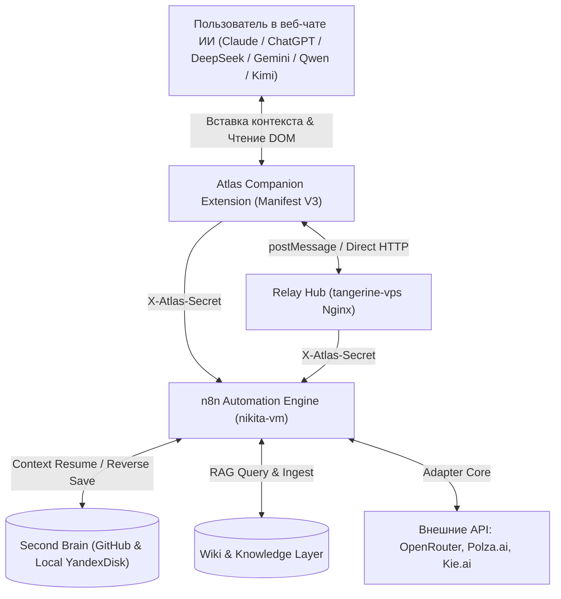
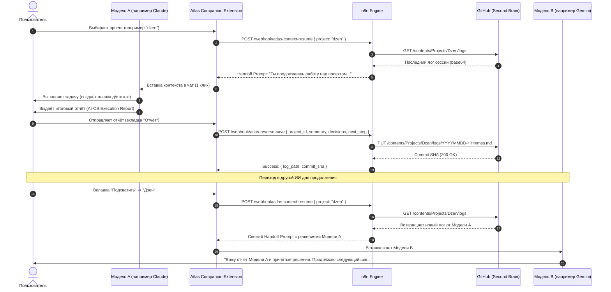

# AI-OS Architecture Specification (Архитектура персональной операционной системы ИИ)

**Версия:** 1.0  
**Дата утверждения:** 2026-10-23  
**Статус:** Реализовано и верифицировано в проде (DoD PASS)  
**Авторы:** Gemini (Ведущий архитектор AI-OS), Nikita Anurev  

---

## 1. Концепция и назначение

Персональная операционная система искусственного интеллекта (**AI-OS**) — это распределённая интеллектуальная среда, объединяющая центральное хранилище знаний (**Second Brain**), шину автоматизации и адаптеров моделей (**Atlas v0.3**) и пользовательский интерфейс взаимодействия с ИИ-моделями (**Atlas Companion Extension** и **Relay Hub**).

Главная задача системы — обеспечить непрерывный, сквозной цикл выполнения задач разными ИИ-моделями (ChatGPT, Claude, Gemini, DeepSeek, Qwen, Kimi) над общими проектами пользователя без потери контекста, без необходимости ручного копирования файлов и без риска повреждения истории.



---

## 2. Ключевые компоненты системы

### 2.1. Second Brain (Единый источник истины)
- **Физическое хранилище:** Локальная папка `D:\YandexDisk\Atlas\second-brain` + удалённый репозиторий GitHub `takeprofit83/second-brain` (ветка `main`).
- **Ответственность:**
  - Долгосрочная память и проектное состояние.
  - Хранение фактов, архитектурных решений (ADR), открытых вопросов, задач и ограничений.
  - Журналирование каждой рабочей сессии в `Projects/<id>/logs/<YYYYMMDD-HHmmss>-<source_ai>-<task_id>.md`.
  - Версионирование через Git SHA и временные метки.
- **Поддерживаемые проекты (`project_id`):**
  1. `atlas` — Платформа автоматизации и ядро AI-OS (`Projects/Atlas/`).
  2. `courses` — Образовательные курсы и технологические конспекты (`Courses/`).
  3. `dzen` — Контент-фабрика, статьи и аналитика Яндекс Дзен (`Projects/Dzen/`).
  4. `nastya` — Рабочее пространство проекта Настя (`Projects/Nastya/`).
  5. `dacha` — Строительство, боты и умный дом загородного дома (`Projects/Dacha/`).
  6. `other` — Универсальная песочница для разовых исследований и тестов (`Projects/Other/`).

### 2.2. Atlas Companion Extension (Manifest V3)
- **Расположение:** `D:\YandexDisk\Atlas\atlas-extension/`
- **Ответственность:**
  - Интерактивный мост между веб-интерфейсами LLM и шиной автоматизации.
  - **Режим Resume (Подхват):** Запрос свежего среза контекста в 1 клик, копирование в буфер обмена и прямая вставка в DOM-элемент ввода любого чата (`#prompt-textarea`, `.ProseMirror`, `rich-textarea`, `textarea`).
  - **Режим Report & Save (Обратная запись):** Приём отчёта о выполненной работе от текущей модели (через форму или вставку JSON-отчёта), валидация и отправка в n8n `atlas-reverse-save`.
  - **Режим Capture (Захват переписки):** Чтение диалога со страницы и отправка в n8n `atlas-capture` для суммаризации через Kie.ai.
- **Платформы:** ChatGPT, Claude, DeepSeek, Gemini, Qwen, Kimi.

### 2.3. Сервер автоматизации n8n (`nikita-vm`)
- **Хост:** `10.40.40.10` за Nginx Proxy Manager с доменом `https://n8n.neiroclone.ru`.
- **База данных:** PostgreSQL 17 Alpine (`postgres`).
- **Боевые воркфлоу:**
  1. `Atlas - Context Resume` (`TyMCUfCLua060sdc`): Webhook `/webhook/atlas-context-resume` (POST). Разрешает путь проекта, читает последний лог из GitHub или выполняет graceful fallback на `project_state.md`, собирает 10-блочный handoff-промпт и возвращает вызывающему агенту.
  2. `Atlas - Reverse Save` (`RvSrV06jBAoB1S9r`): Webhook `/webhook/atlas-reverse-save` (POST). Принимает отчёт от работающей модели, проверяет контракт, генерирует структурированный Markdown и сохраняет коммит в GitHub репозиторий через Contents API.
  3. `Atlas - Wiki Query` (`WkQyV06jBAoB1S9r`): Webhook `/webhook/atlas-wiki-query` (POST). Извлекает индекс базы знаний `Knowledge/index.md`, отправляет вопрос с контекстом в модель-адаптер (Polza/OpenRouter) и возвращает точный ответ со ссылками на страницы.
  4. `Atlas - Wiki Ingest` (`WkIgV06jBAoB1S9r`): Webhook `/webhook/atlas-wiki-ingest` (POST). Разбирает конспекты и обновляет базу знаний `Knowledge/`.
  5. `Atlas - Kie Adapter` (`ls5hJoxIFtUycpKH`): Webhook `/webhook/atlas-capture` (POST). Чанкинг и суммаризация длинных чатов.
  6. `Atlas - Docs Sync` (`B4Z9lptq8i4e9Kur`): Прямая синхронизация произвольных файлов в GitHub.
  7. `Atlas-OpenRouter Adapter Core` (`FCHKR5wwDT1ZYdKu`): Универсальный адаптер к OpenRouter API.
  8. `Atlas-Polza Adapter Core` (`gu85dO6jBAoB1S9r`): Универсальный адаптер к Polza.ai API.

### 2.4. Relay Page (`tangerine-vps`)
- **Хост:** `195.19.12.38`, путь `/var/www/html/atlas-relay-d42332f0300f625f.html`.
- **Ответственность:** Защищённый прокси-хаб для букмарклетов и внешних клиентов, обходящий Content Security Policy (CSP) сторонних чатов через стандартный механизм `window.opener.postMessage`.

---

## 3. Сквозной цикл взаимодействия (End-to-End Cycle)



---

## 4. Контракты и форматы данных

### 4.1. Контракт отчёта ИИ (`Templates/project_report_schema.json`)
```json
{
  "project_id": "atlas | courses | dzen | nastya | dacha | other",
  "task_id": "string",
  "source_ai": "string",
  "summary": "Краткое описание выполненного",
  "completed_actions": ["действие 1", "действие 2"],
  "pending_actions": ["действие 3"],
  "files_modified": ["путь/к/файлу"],
  "decisions_made": [{"id": "ADR-xxx", "title": "...", "description": "..."}],
  "new_facts": ["факт 1"],
  "next_step": "Конкретный следующий шаг для продолжения работы",
  "suggested_handoff": "Опциональный готовый текст передачи"
}
```

### 4.2. Контракт состояния проекта (`Templates/project_state_schema.json`)
Хранится в `<Project>/project_state.md` и валидируется по схеме из 17 полей: `project_id`, `title`, `target_goal`, `status`, `updated_at`, `state_version`, `next_step`, `confirmed_facts`, `decisions`, `open_questions`, `assumptions`, `constraints`, `current_tasks`, `completed_actions`, `pending_actions`, `document_links`, `artifacts`.

---

## 5. Точки отказа и механизмы надёжности

| Компонент / Риск | Возможная точка отказа | Механизм защиты и восстановления |
|---|---|---|
| **Сеть / n8n** | Временная недоступность n8n | Companion Extension дублирует текст в буфер обмена (`navigator.clipboard`); статусная плашка информирует об ошибке сети без потери введённых данных. |
| **GitHub Contents API** | Отсутствие логов в проекте (HTTP 404) | Graceful fallback в `Atlas - Context Resume`: автоматическая подгрузка `project_state.md` вместо падения. |
| **DOM чата** | Изменение вёрстки сайта LLM | Селекторный стек из 7 вариантов + fallback на `navigator.clipboard.writeText()` (пользователю достаточно нажать Ctrl+V). |
| **Авторизация** | Подделка или перехват вебхука | Обязательный заголовок `X-Atlas-Secret` на всех вебхуках; отклонение любых неавторизованных запросов с HTTP 401. |
| **Повреждение данных** | Конфликты перезаписи файлов | Атомарное добавление логов с уникальными именами `YYYYMMDD-HHmmss-<source>-<task>.md` исключает перезапись существующих файлов. |
